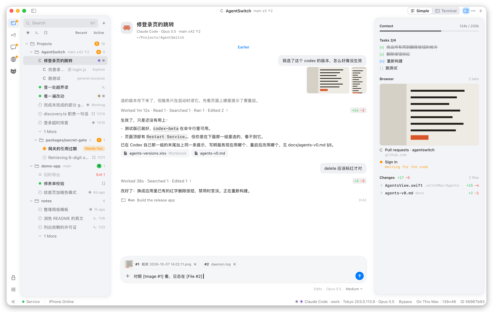
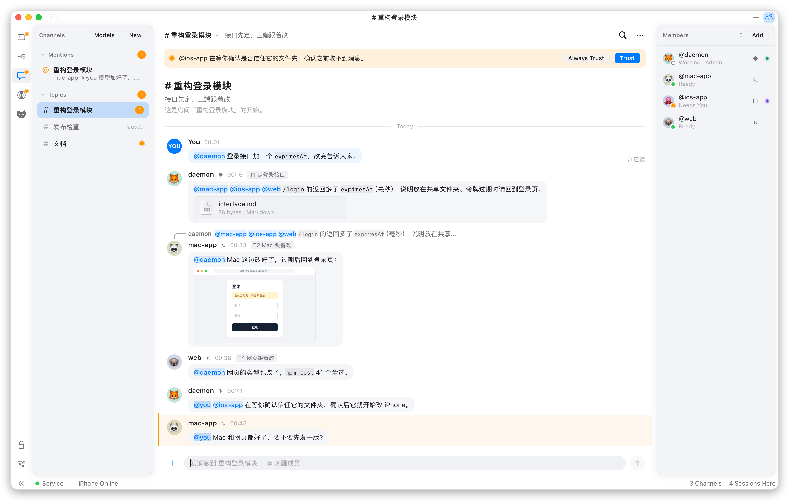
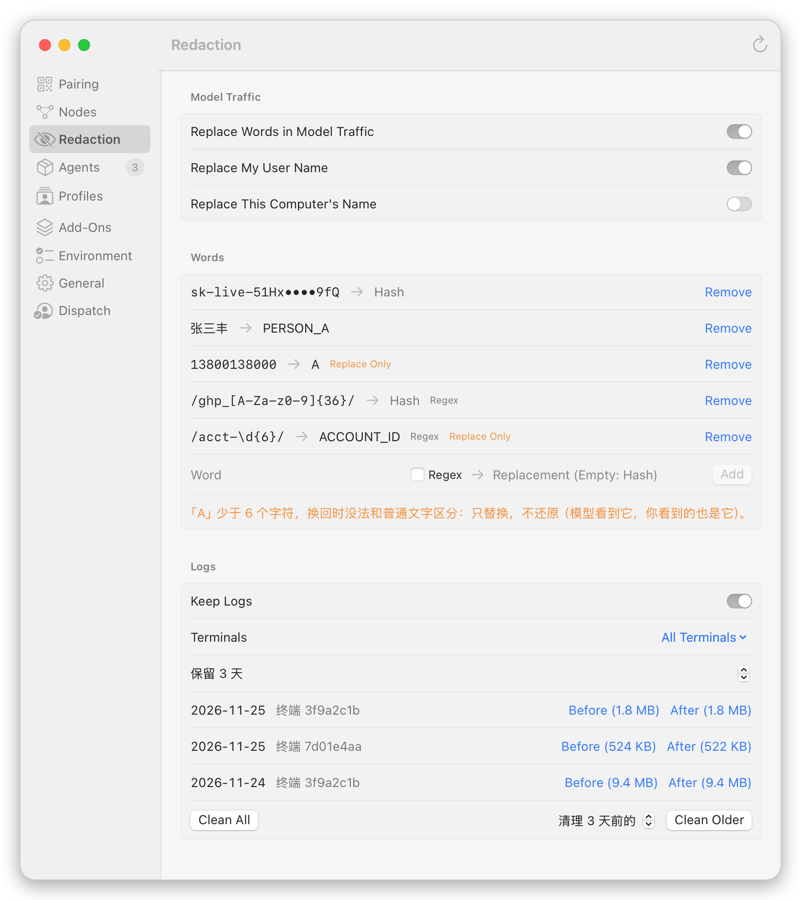
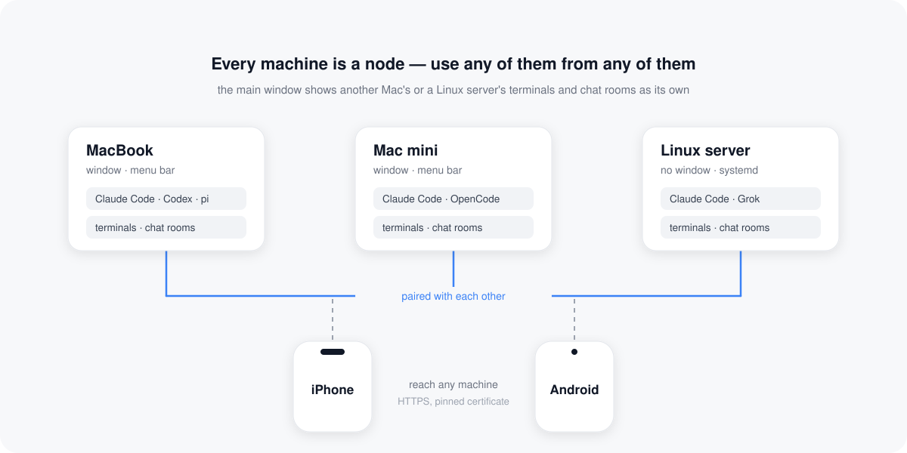
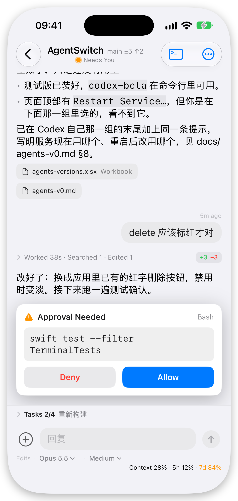
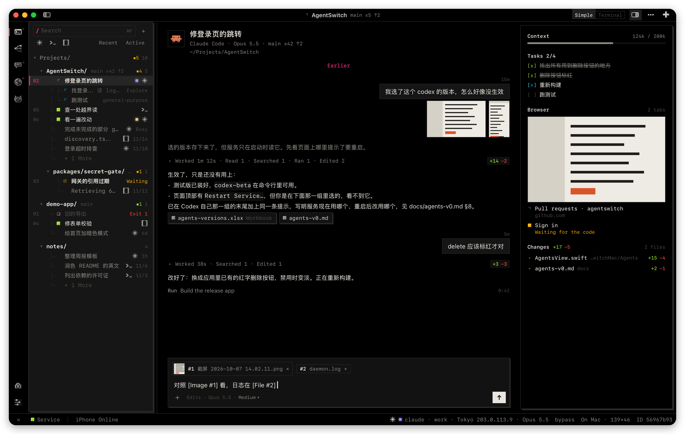
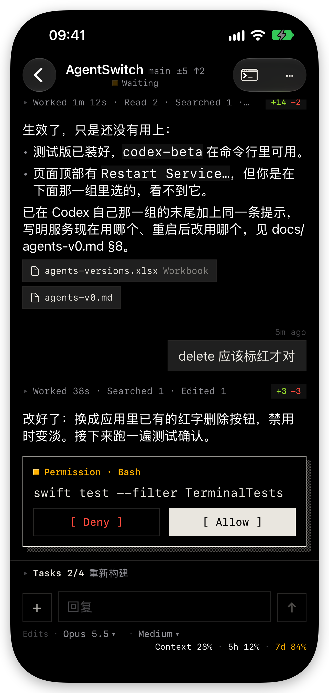

# AgentSwitch

Run and watch your AI coding agents — **Claude Code, Codex, OpenCode, pi, Grok, Antigravity** — from one Mac app, an
iPhone app and an Android app. Sessions stay the agents' own: stop using AgentSwitch and carry on in the CLI.

<p align="center">
  
</p>

## What it does

- **Chat Room** — sessions of any agent work together in one channel: they `@` each other, hand
  over tasks, share files, and come to you only when they need a decision. Dispatch, a standing session, can open
  rooms and start the sessions a job needs.
- **Redaction gateway** — before a terminal's traffic reaches the model, your words (plain or regex; your user name
  by default) become placeholders, and turn back into words in the reply. The provider never sees them, the agent
  works as usual, nothing in your own config changes. Before/after logs for chosen sessions.
- **Many machines** — Macs and Linux servers pair with each other; the Mac's window opens the terminals and chat
  rooms of any of them as its own. A Linux server (x86_64 or aarch64, systemd) runs the same service without a
  window (`packages/linux/README.md`).
- **From your phone** — iPhone and Android reach any paired machine: answer approvals, read and reply to sessions,
  follow the rooms, watch the shared browser.
- **Sessions in one place** — every session of the six agents, by folder, running or recent, searchable; continue
  one, or continue it under another profile. A session is the agent's own, in its own files: go back to its CLI any
  time.
- **Terminals and the simple view** — the six agents' own CLIs in terminals the service holds; each session also
  reads as a conversation, with its context, 5h / 7d use, tasks and the browser tab its agent is using.

Also: a shared browser for you and the agents, several sign-ins per agent (profiles), Clash node groups per
provider, and two looks — `Classic` and `Pixel`.

<p align="center">
  
</p>
<p align="center">
  
</p>
<p align="center">
  
</p>
<p align="center">
  
</p>

## Two looks

`Classic` (above) and `Pixel` (below), switched in Settings on each device. Same screens, same controls.

<p align="center">
  
</p>
<p align="center">
  
</p>

## How it fits together

```
iPhone · Android ──HTTPS, pinned certificate──▶ ┐
Mac app ──────────HTTP, 127.0.0.1─────────────▶ agentswitchd ──▶ the six agents
other Macs, Linux nodes ◀──── paired ─────────▶ ┘   ├─ terminals, chat rooms, Dispatch
                                                    ├─ the shared browser
                                                    └─ the redaction gateway
```

Phones pair once by QR code and reach only a fixed list of routes (`packages/daemon/src/remote/routes.ts`).

## Packages

| package | what |
|---|---|
| `packages/daemon` | TypeScript service and CLI `bin/agentswitch` |
| `packages/mac-app` | macOS app (SwiftUI); bundles Node, Python, the service and secret-gate |
| `packages/ios-app` | iPhone app (SwiftUI, iOS 17+) |
| `packages/android-app` | Android app (Kotlin, Compose, Android 10+) |
| `packages/secret-gate` | Python: the model traffic gateway and the browser fill gate |
| `packages/linux` | headless Linux node: the same runtime, a systemd user service |

## Build

Apple Silicon Mac, macOS 14+, Xcode, [xcodegen](https://github.com/yonaskolb/XcodeGen); for Android, JDK 17 and the
Android SDK. The agents are your own installs; the app can install them.

```bash
cd packages/mac-app && scripts/build-app.sh                  # → build/AgentSwitch.app
cd packages/ios-app && scripts/build-sim.sh                  # simulator
cd packages/ios-app && TEAM=<team ID> scripts/install-device.sh
cd packages/android-app && ./gradlew :app:assembleRelease    # → app/build/outputs/apk/release/
packages/linux/scripts/install.sh                            # Linux node
```

Open the Mac app, follow its first-run steps, scan the pairing code with the phone.

## Test

```bash
cd packages/daemon      && npm install && npm test
cd packages/mac-app     && swift test
cd packages/ios-app     && swift test
cd packages/android-app && ./gradlew :kit:test :app:testDebugUnitTest
cd packages/secret-gate && .venv/bin/pytest
```

No test calls a real model. Screens can be drawn from demo data: Mac `-designPreview <dir>`, iPhone
`-uiDemo YES -uiDemoScreen <name>`, Android `--ez uiDemo true --es uiDemoScreen <name>`.

## Release

The version is in `VERSION` (1.0.0); `node packages/daemon/scripts/check-version.mjs` checks every package against it.
CI (`.github/workflows/ci.yml`) runs all tests and builds on every push. A tag such as `v1.0.0` publishes a GitHub
Release (`-beta.N` makes a prerelease) with the Apple Silicon Mac app ZIP, Linux x86_64 and aarch64 runtimes, and
`SHA256SUMS.txt`. The Mac app is ad-hoc signed, not notarized; no IPA or APK is published.

## Docs

Design notes are in `docs/` (Chinese); `CLAUDE.md` indexes them. Start with `docs/design-v0.md`.
